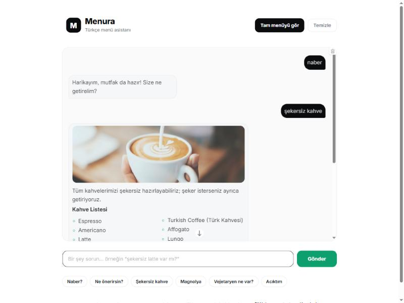
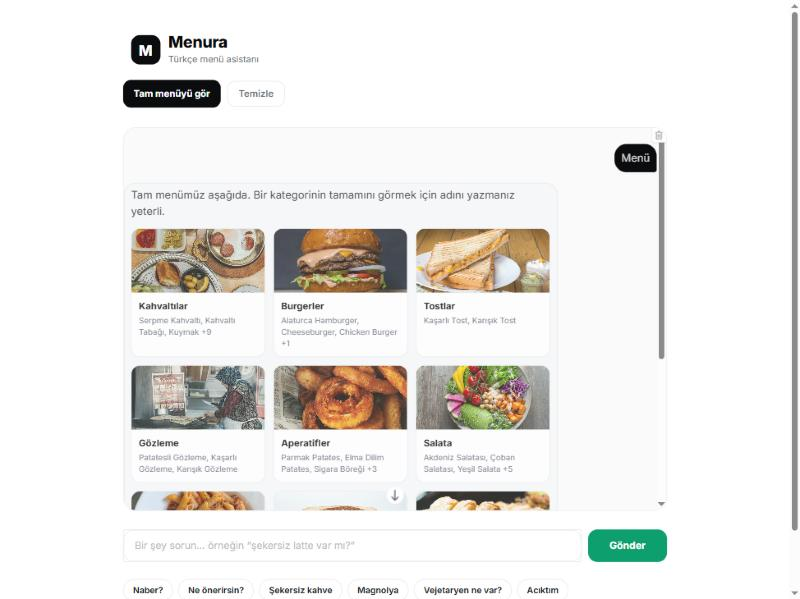

# Menura

**A retrieval-based Turkish menu assistant with a web interface and a terminal interface.**

Menura answers questions about a café menu in Turkish. It normalizes the question with Turkish NLP preprocessing, turns it into TF-IDF vectors and finds the closest topic or product in a local knowledge base with cosine similarity. A character n-gram search tolerates typos and missing Turkish letters, option rules handle requests such as "şekersiz" or "sütsüz", and a short conversation memory answers follow-ups like "şekersiz mi peki?".



## Features

- **Topics with synonyms:** "kahveler", "sıcak bir şey", "kola", "hafif bir şey" or "neler var?" return the matching menu category with its photo.
- **Products:** "latte var mı?" or "sucuklu yumurta" finds the product inside its category.
- **Typo tolerance:** "magnolya", "kapuçino", "espreso", "kunefe" or "cay" still find Magnolia, Cappuccino, Espresso, Künefe and Bardak Çay. Approximate matches are labelled as such, never presented as exact.
- **Options:** "şekersiz kahve", "laktozsuz", "buzlu", "acılı", "vejetaryen" or "duble" add a category-specific note to the answer ("Tüm kahvelerimizi şekersiz hazırlayabiliriz").
- **Follow-ups:** after the coffee list, "sütsüz olur mu peki?" is answered for coffees.
- **Small talk:** greetings, "naber?", "iyiyim", "kimsin?", "acıktım", thanks and goodbyes, with rotating replies. "Ne önerirsin?" builds a recommendation from real menu items.
- **Honest fallback:** questions outside the menu ("pizza", "wifi şifresi") get a guiding message instead of a random answer.
- **Photo menu:** "Tam menüyü gör" shows every category as a photo card.
- **Explainable answers:** menu answers carry a small label with the matched category or product, the option and the similarity score.
- **Two interfaces, one engine:** a Gradio Blocks web app and the terminal chat share the same `menura` package.
- **Tests:** 20 unit tests cover topics, synonyms, products, typos, options, follow-ups, small talk, fallbacks and formatting.



## How it works

```
question
  -> option rules: find "şekersiz", "sütsüz", "buzlu" ... and set them aside
  -> Turkish-aware lowercase, tokenize (NLTK), strip punctuation
  -> remove Turkish stopwords and question words ("var mı", "istiyorum")

  1. word match    Snowball stemming + TF-IDF, cosine similarity against
                   every topic name and tag, and against every product.
                   Scores are scaled by the share of query words the index
                   knows; the stronger of topic and product wins.
  2. fuzzy match   character 2-4 gram TF-IDF on text with Turkish letters
                   folded (ç->c, ş->s, ı->i), for typos and spelling variants
  3. fallback

  -> an option adds the note for the matched category, or for the
     previous answer's category when the message is a follow-up
```

| Stage | Threshold |
| --- | --- |
| Word match, topic | 0.25 |
| Word match, product | 0.50 (below 0.90 is answered as an approximate match) |
| Fuzzy match, product / topic | 0.55 / 0.75 |

The thresholds were chosen by scoring a set of known and unknown questions; unknown questions such as "pizza", "kebap" or "wifi şifresi" stay below them.

## Tech stack

Python · NLTK · Snowball Stemmer · scikit-learn (TF-IDF, cosine similarity) · NumPy · Gradio

## Project structure

```
menura/
  engine.py       preprocessing, TF-IDF indexes, option rules and the reply logic
  formatting.py   turns plain-text answers into Markdown for the web UI
data/
  menu.json       knowledge base: topics, tags, answers, photos and option rules
assets/           logo and menu photos
app.py            Gradio Blocks web interface (also the Hugging Face Spaces entry point)
main.py           terminal interface
tests/            unit tests
docs/             screenshots and photo credits
```

## Setup

```bash
git clone https://github.com/ceylanumit/menura.git
cd menura
python -m venv .venv
```

Activate the virtual environment (`.venv\Scripts\activate` on Windows, `source .venv/bin/activate` on macOS/Linux), then install the dependencies:

```bash
python -m pip install -r requirements.txt
```

The required NLTK resources (`punkt`, `punkt_tab`, `stopwords`) are downloaded automatically on first run.

## Usage

Web interface, served at http://127.0.0.1:7860:

```bash
python app.py
```

Terminal interface (type `çıkış` to quit):

```bash
python main.py
```

Run the tests:

```bash
python -m unittest -v
```

## Knowledge base

`data/menu.json` holds a welcome message, a fallback message, the entries and the option rules.

```json
{
  "user_input": "Kahveler",
  "bot_response": "★★★ Kahve Listesi ★★★\n Espresso\n Latte\n ...",
  "tags": ["Kahve", "sıcak bir şey"],
  "image": "assets/menu/kahve.jpg"
}
```

- `user_input` and each tag are indexed as separate phrases, so adding synonyms never weakens the others.
- Each line of `bot_response` (except titles and notes) is indexed as a product. Set `"index_items": false` on entries such as greetings that should not be searched for products.
- `bot_response`, `welcome` and `fallback` can be a list of alternatives; one is picked at random.
- An entry with `"action": "recommend"` fills its template with random products from the topics in `recommend_from`.

Option rules live under `modifiers`:

```json
{
  "name": "şekersiz",
  "patterns": ["şekersiz", "şeker olmasın"],
  "notes": {"Kahveler": "Tüm kahvelerimizi şekersiz hazırlayabiliriz; ..."},
  "default": "Siparişinizi şekersiz isteyebilirsiniz; ..."
}
```

A pattern matches the start of a word with Turkish letters folded ("sekersizi" counts); a pattern starting with `=` must match a whole word, so `=ice` does not fire on "içecek".

## Deploying the demo to Hugging Face Spaces

1. Create a new Space at https://huggingface.co/new-space and choose the **Gradio** SDK.
2. Upload `app.py`, `requirements.txt` and the `menura/`, `data/` and `assets/` folders.
3. The Space builds automatically and serves `app.py`.

## Limitations

Answers are retrieved from the knowledge base, not generated. Matching is lexical: a synonym that is neither listed in `tags` nor close in spelling to a menu item is not recognized. The conversation memory only keeps the last menu category.

Menu photos are from Unsplash; see [docs/CREDITS.md](docs/CREDITS.md).
